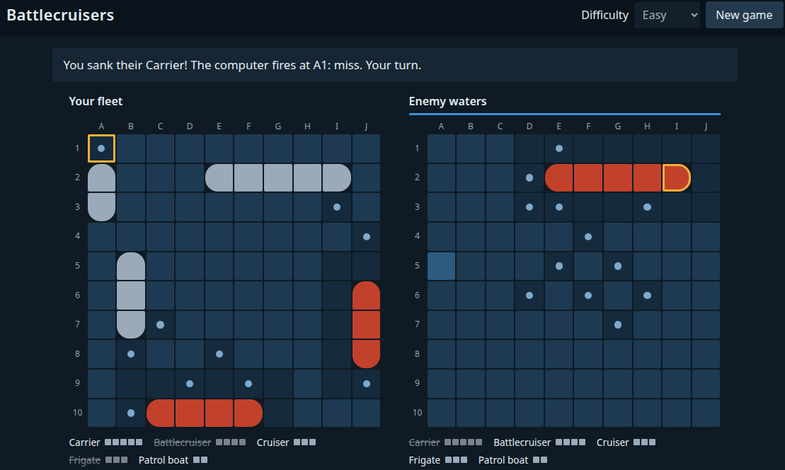

# Battlecruisers

A simple, standalone version of the classic naval grid game. Hide your fleet, then trade shots with the computer until one side is sunk.

**[Play it online](https://onckelinx.github.io/battlecruisers/)**

**Or play offline:** download this repository (**Code → Download ZIP**), unzip it and double-click `index.html`. There is nothing to install.

- 10×10 grid, five ships and three difficulty levels
- Place your ships by hand or at random
- Plain HTML, CSS and JavaScript, with no dependencies

Released under the [MIT License](LICENSE).
